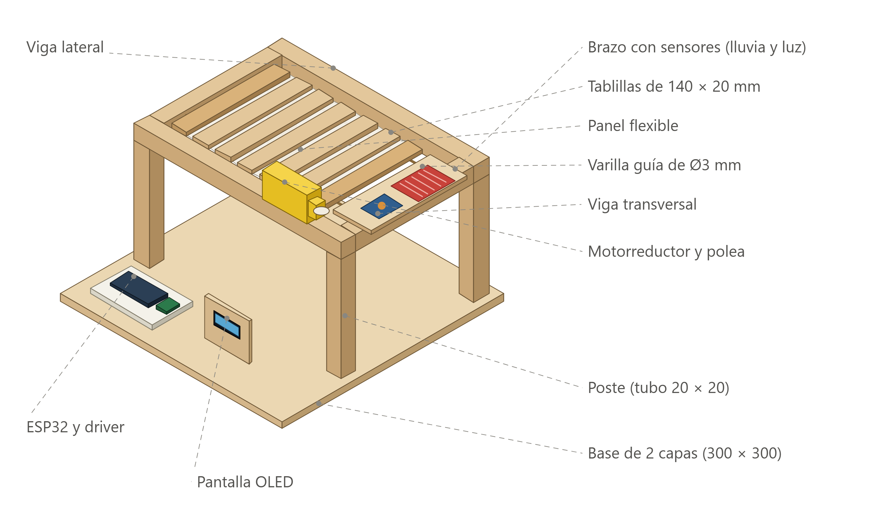
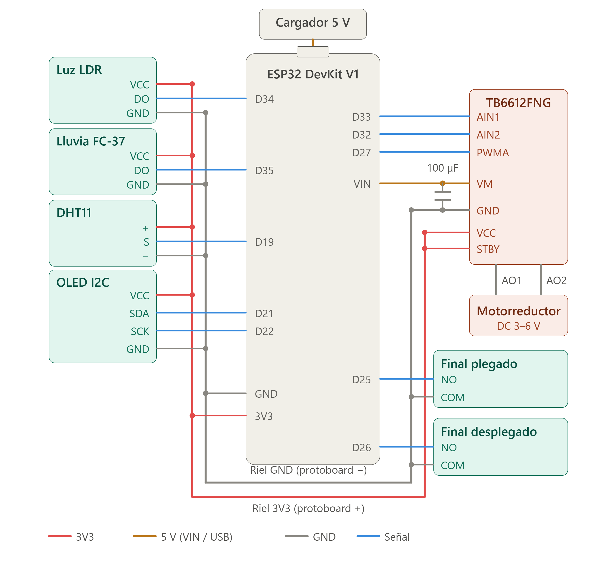

# CacaoCover

Techo plegable automático para el secado de cacao. Un ESP32 lee los sensores (lluvia, luz, temperatura y humedad), mueve el motor que pliega o despliega el panel y envía los datos por USB a la laptop. Allí un backend en Node.js los guarda en SQLite y los muestra en un dashboard web en `localhost`.



## Estructura del proyecto

| Carpeta | Qué contiene |
|---|---|
| `firmware/` | Código del ESP32 (PlatformIO, framework Arduino) |
| `backend/` | Node.js + Express: lee el puerto USB, guarda en SQLite, expone API REST y WebSocket |
| `frontend/` | Dashboard en Preact + Vite + TypeScript |
| `tools/` | Scripts de grabación, simulador y exportación a Arduino IDE |
| `docs/` | Protocolo serie, contrato de API, pines, seguridad e imágenes |
| `design-reference/` | Diseño de referencia del dashboard (solo lectura) |

## Requisitos

| Herramienta | Versión | Para qué |
|---|---|---|
| [Node.js](https://nodejs.org/) | **22.5 o superior** (probado con 24) | Backend y dashboard. Usa `node:sqlite`, que viene incluido |
| [PlatformIO Core](https://platformio.org/install/cli) | 6.x | Compilar y grabar el firmware (`pip install platformio`) |
| Driver USB CP210x o CH340 | — | Que Windows reconozca el ESP32 como puerto COM |
| Git | — | Clonar el repositorio |

> Si prefieres Arduino IDE en vez de PlatformIO, consulta [Grabar con Arduino IDE](#opción-b-arduino-ide).

## Hardware

| Componente | Pin ESP32 |
|---|---|
| Sensor de luz LDR (DO) | D34 |
| Sensor de lluvia FC-37 (DO) | D35 |
| DHT11 (S) | D19 |
| OLED I²C (SDA / SCK) | D21 / D22 |
| TB6612FNG (AIN1 / AIN2 / PWMA) | D33 / D32 / D27 |
| Final de carrera "plegado" (NO) | D25 |
| Final de carrera "desplegado" (NO) | D26 |

- Sensores, OLED, VCC y STBY del driver van al riel de **3V3**. Todas las tierras van al riel **GND** común.
- El motor (VM del TB6612FNG) se alimenta desde **VIN (5 V del USB/cargador)**, con un condensador de **100 µF** entre VM y GND.
- Los finales de carrera conectan NO al pin y COM a GND (el firmware usa pull-up interno).



Más detalle en [docs/pines.md](docs/pines.md).

---

## Guía de ejecución

### 1. Clonar e instalar dependencias

```bash
git clone https://github.com/JuanGuillermo1236/Dasboart-ESP32-puerta-enrrollable.git
cd Dasboart-ESP32-puerta-enrrollable

cd frontend
npm install
npm run build        # genera frontend/dist, que sirve el backend
cd ../backend
npm install
```

### 2. Probar sin placa (modo simulado)

Útil para ver el dashboard sin hardware o como plan B en una presentación:

```bash
cd backend
npm run simular
```

Abre **http://localhost:3000**. La cabecera muestra "SIMULADO".

### 3. Grabar el firmware en el ESP32

El puerto está fijado en **COM3** en [firmware/platformio.ini](firmware/platformio.ini) (`upload_port` y `monitor_port`). Cámbialo si tu placa aparece en otro puerto (Administrador de dispositivos → Puertos COM).

#### Opción A: PlatformIO (recomendado)

Cierra cualquier monitor serie y el backend (el puerto solo puede usarlo un programa). Luego:

```bash
cd frontend
npm run flash
```

Mantén pulsado **BOOT** en el ESP32 mientras se graba. Al terminar se abre la consola serie, que muestra una línea JSON por mensaje. Puedes escribir comandos como `{"cmd":"cerrar"}` y pulsar Enter. Sal con `Ctrl + C`.

Para solo compilar, sin tocar la placa: `npm run flash -- --solo-compilar`.

#### Opción B: Arduino IDE

```bash
cd frontend
npm run arduino
```

Genera `firmware/arduino/CacaoCover/CacaoCover.ino`. Ábrelo en Arduino IDE con la placa **DOIT ESP32 DEVKIT V1** e instala las librerías **ArduinoJson**, **DHT sensor library**, **Adafruit Unified Sensor** y **U8g2**.

### 4. Ejecutar con la placa conectada

Con el firmware grabado, el ESP32 conectado por USB y ningún monitor serie abierto:

```bash
cd backend
npm start
```

Abre **http://localhost:3000**. El backend busca el ESP32 automáticamente. Si no lo encuentra, indica el puerto:

```powershell
# PowerShell
$env:PUERTO_SERIE="COM4"; npm start
```

```bash
# Git Bash / Linux / macOS
PUERTO_SERIE=COM4 npm start
```

Los datos se guardan en `backend/datos/cacaocover.db`. Variables de entorno disponibles:

| Variable | Por defecto | Uso |
|---|---|---|
| `PUERTO_SERIE` | detección automática | Puerto COM del ESP32 |
| `PUERTO_HTTP` | `3000` | Puerto del dashboard y la API |

### 5. Probar cada componente por separado (opcional)

Graba un firmware de diagnóstico que se maneja desde la consola serie:

```bash
cd frontend
npm run prueba
```

Escribe una letra (sin Enter):

| Tecla | Prueba |
|---|---|
| `s` | Muestra sensores cada 2 s |
| `i` | Busca la OLED en el bus I²C |
| `1` / `2` | Dibuja en la OLED como SH1106 / SSD1306 |
| `p` / `d` | Mueve el motor hacia plegado / desplegado, con rampa |
| `x` o cualquier tecla | Detiene el motor |
| `+` / `-` | Sube o baja el PWM (máximo 170) |

Después vuelve a grabar el firmware completo con `npm run flash`.

---

## Desarrollo

| Comando | Carpeta | Qué hace |
|---|---|---|
| `npm run dev:sim` | `frontend/` | Backend simulado + dashboard con recarga en caliente en http://localhost:5173 |
| `npm run dev` | `frontend/` | Solo Vite (necesita el backend corriendo en el puerto 3000) |
| `npm run build` | `frontend/` | Compila el dashboard a `frontend/dist` |
| `npm test` | `frontend/` | Pruebas del dashboard (Vitest) |
| `npm run lint` | `frontend/` | ESLint |
| `npm test` | `backend/` | Pruebas del backend (`node --test`) |
| `pio test -e native` | `firmware/` | Pruebas de la lógica de control en la PC |

Después de cambiar el dashboard, ejecuta `npm run build` para que `npm start` sirva la versión nueva.

## Solución de problemas

| Problema | Solución |
|---|---|
| `Access denied` o puerto ocupado al grabar | Cierra el backend y cualquier monitor serie |
| La grabación se queda en `Connecting...` | Mantén pulsado **BOOT** durante toda la grabación |
| El backend no encuentra la placa | Revisa el cable (que sea de datos) y usa `PUERTO_SERIE` |
| `No such built-in module: node:sqlite` | Actualiza Node.js a 22.5 o superior |
| El dashboard en :3000 no muestra cambios | Ejecuta `npm run build` en `frontend/` |
| El motor no se mueve | Revisa STBY a 3V3, VM a VIN y el GND común con el driver |

## Documentación

- [docs/protocolo-serie.md](docs/protocolo-serie.md): mensajes JSON entre ESP32 y backend
- [docs/api-contract.md](docs/api-contract.md): API REST y WebSocket del backend
- [docs/pines.md](docs/pines.md): conexiones y pines
- [docs/seguridad.md](docs/seguridad.md): reglas de seguridad del motor y del control
